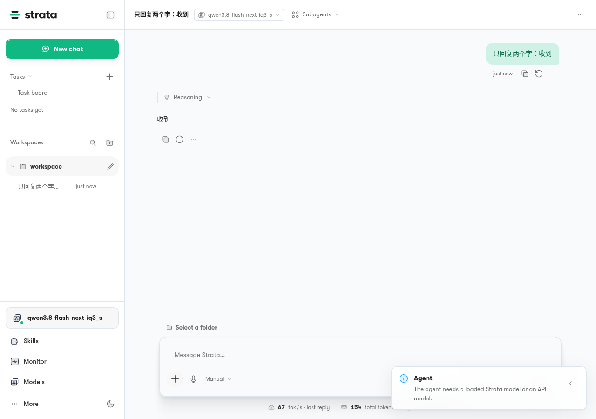
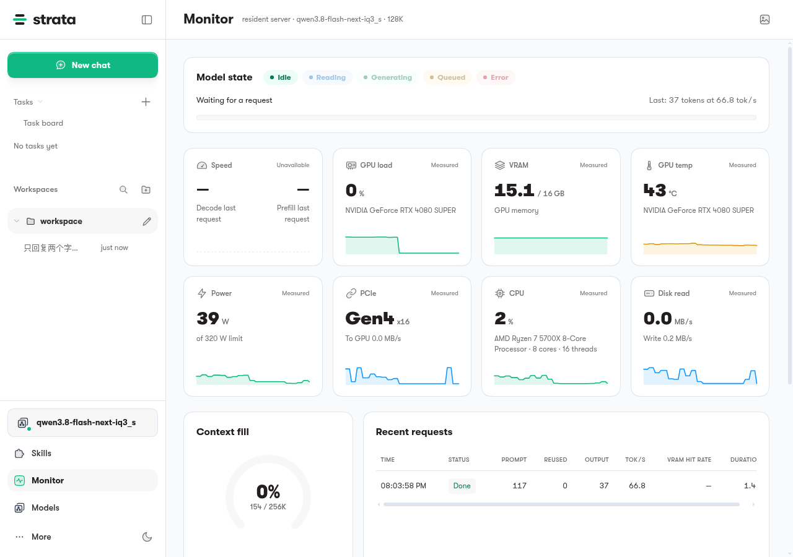
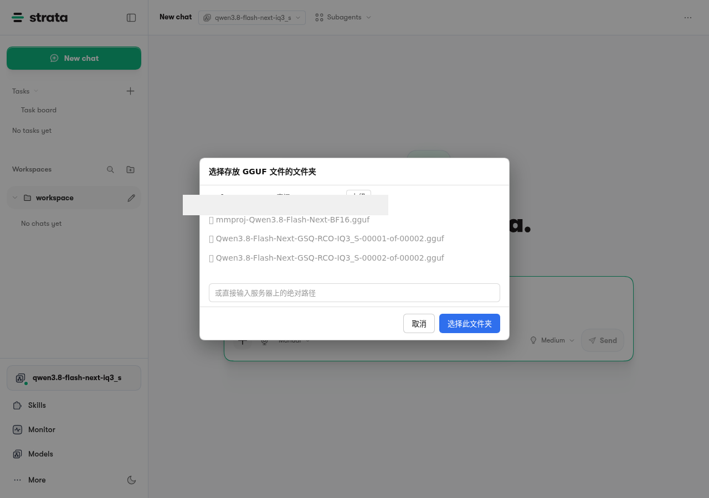

# Strata on fnOS — 移植层

## 运行截图

| 聊天（经真引擎） | 资源监控 | 模型文件夹选择 |
|---|---|---|
|  |  |  |

跑在 fnOS（fnNAS）上：RTX 4080 SUPER，常驻模型 128K 上下文，约 67 tok/s。

这是 [Strata](https://github.com/Niko1221/Strata) 在 **fnOS（飞牛私有云）** 上的 fpk 移植层。
不含上游源码改动：fnOS 安装的是上游 release 的预构建产物（AppImage 剥壳 + engine/control tar.gz），
本仓库只包含让它在 fnOS 应用中心里正确安装、启动、走网关、被生命周期管理的**外壳**。

## 目录

```
├── manifest          # fpk 元数据（appname=strata-app）
├── cmd/              # 生命周期脚本（start/stop/status/install/upgrade/uninstall）
├── config/           # privilege / resource 声明
├── ui/               # 应用中心入口配置 + 图标
├── sock_proxy.py     # fnOS 网关 Unix socket → 本机端口的代理
│                     #（重写 /app 前缀、注入 X-Forwarded-Prefix、WS 全双工直通、剥离 Origin/Referer）
└── docs/             # 移植注意事项（见下）
```

## 打包

`app/` 载荷不在 git 里（体积 >1.7GB，为上游二进制）。打包步骤：

1. 从上游 release 下载对应硬件的产物：`Strata-<ver>-linux-nvidia-cuda*.AppImage`
   （`--appimage-extract` 剥出 host/harness）、`strata-engine-*-cuda*.tar.gz`、
   `strata-control-*.tar.gz`、node 运行时
2. 按 `cmd/main` 内的路径约定布置 `app/{node,host,harness,engine-bundle,control,sock_proxy.py,ui}`
3. `fnpack build --directory strata-app`
4. 注意（fnOS 安装器硬约束）：`app.tgz` 内**不得含任何软/硬链接条目**，
   否则报"解压app.tgz失败"；打包前用 `tarfile` 审计 type 只有 dir+reg。

## 关键约束（踩过的坑）

- fnOS 网关**不剥路径前缀**：代理必须自己重写请求行 + Host，并注入 `X-Forwarded-Prefix`
- 浏览器 Origin/Referer 带网关域名会触发上游 loopback 防重绑定 → 代理必须剥离这两个头
- SSE 要无超时直通；keep-alive 响应按 HTTP/1.1 分帧转发
- fnOS glibc 2.36：选上游构建前先确认它的 glibc 门槛
- 同版本号覆盖安装不一定刷新文件：改了载荷必须递增 `manifest` 的 `version`
- 图标读取路径：应用中心读 `app.tgz` 内 `ui/images/icon_*.png` 与包根 `ICON.PNG`/`ICON_256.PNG`
- `cmd/main status` 未运行时退出码必须是 `3`
- 上游自升级（应用中心外）需封锁/说明，升级走应用中心覆盖安装

## 运行时

- 面板端口规划 `18095-18099`，只绑 `127.0.0.1`
- 引擎（OpenAI 兼容 `/v1`）默认端口 `8080`；面板启动时探测 `http://127.0.0.1:8080/health`
  的 `"service":"strata"` 指纹，已有引擎则连接（A 模式），否则自行加载
- API key 安装时由 `install_callback`（root 阶段）生成到应用数据目录，随安装随机，
  仓库中不含任何密钥

## 许可

上游 Strata 的许可约束适用于所有二进制产物；本移植层脚本按上游仓库同等条款提供。


## 版本策略（2026-10-23 起）

- manifest `version` **必须等于上游官方版本号**（如上游 v0.2.3 → manifest 0.2.3），不再自造 0.2.1x 修订段。
- 历史遗留：曾发过自造的 0.2.17 / 0.2.18 包，fnOS 按数字段比较会判 0.2.17 ≥ 0.2.3，直接拦截覆盖安装（实测 VM 报"已安装相同或更高版本"）。已装旧号的机器升级 0.2.3 需先卸载再安装（数据目录 /vol1/@apphome|@appdata/strata-app 会被保留）。
- 组件内部版本（control 0.1.48 / engine 0.1.48 / harness 0.2.1-alpha.3）与 manifest 号是两套编号，属正常。

## 升级配方（一键）

```bash
# 原料（GitHub release v<VER>）: SHA256SUMS.txt + linux-update.AppImage + engine cuda13 tar
./rebuild_strata.sh <VER>
```

流程: SHA256 校验 → 解 update.AppImage（control/harness/host/node；engine 用独立 cuda13 tar，目录名 `<cver>-linux-x86_64-cuda-cuda13`）→ host 重贴 port-patches/ 补丁 + folder-picker.js + index.html 注入 → **不变量兜底：不允许残留 `await chooseFolder(`（headless 必须全桥接为 pickFolderBrowser）** → manifest=官方版本 → fnpack → verify_strata.py 全绿才算过。

## 自验

`python3 verify_strata.py strata-app.fpk <VER>`：manifest、零内层链接、cmd 语法、sock_proxy、8 个补丁标记（含 no-chooseFolder-remains）。
